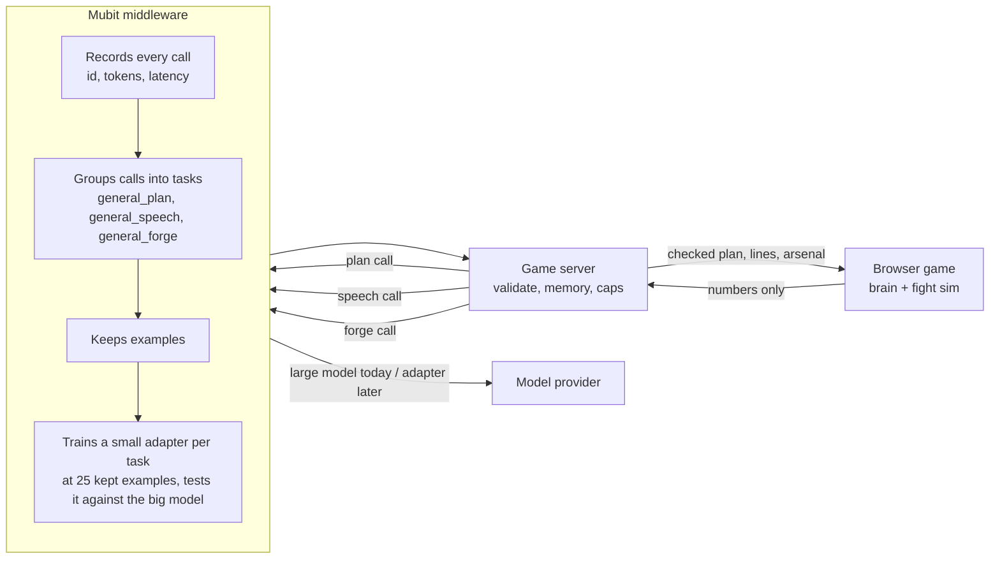

# Kioku: Blades That Remember

> **Bored of fighting the same boss, with the same moves, again and again?**

<p align="center">
  
</p>

Every boss fight you have ever lost, you won by learning the boss. Once you know the pattern, you can beat it
blindfolded, and the boss never learns a thing about you. **Meet Kioku.** The generals here study *you*: how you
cut, guard, deflect, dodge and where you stand. After every duel, won or lost, they come back harder and
*different*: new combos, new moves, a changed way to fight you, and a condition you must break before they bleed.

---

## The problem

- **Bosses are scripts.** A boss is a fixed list of moves. Players memorise it, then one-shot it. The fight that
  felt epic the first night is a chore the fifth.
- **"Adaptive" AI is shallow.** Most games only nudge a difficulty number. The boss never changes *how* it fights.
- **Large models are the wrong tool for the moment.** A large model on every swing costs money, adds delay and can
  break a fair fight. But a model *between* duels, choosing what the boss becomes next, is exactly the job it is good at.
- **Studios cannot rent a frontier model per player forever.** The model's judgement has to move into a small,
  cheap model that is trained on the game's own traffic.

## The product

Kioku is a browser samurai duel (Three.js, no install) in three chapters, three very different generals, and one
rule: **the general remembers you.**

| Layer | What it does |
|---|---|
| **The brain** (game code, works offline) | Reads your style (attack, guard, deflect, dodge, where you stand). Scores which of his own moves land on you. His level has **no ceiling**. After every duel he gets new combos, learns new moves, feints, swings at uneven speeds, answers your dodge, and turns on you in a **remembered form** when nearly beaten. |
| **The condition** | He can only be hurt on a condition aimed at your favourite style: right after a deflect, right after a dodge, only while he is open, or only once his posture is broken. Your favourite trick stops working, so you must change. |
| **The language model** (via Mubit) | Between duels, three model calls (below) plan his next fight, **design his arsenal** (new named combos, tactic, condition, a move to teach him) and write what he says to you. |
| **The arsenal** | 12 real combos from the hardest fights (Isshin, the Owl, Malenia, Artorias, Lord Shimura...), written in this game's moves, each with why it is hard and what answers it. Close fighters get kited, kiters get crowded. |

<p align="center">
  
  
</p>

---

## Mubit is in the loop

[Mubit](https://mubit.ai) sits between the game server and the model provider. It is how the game's own traffic
becomes a cheaper, faster model that does one job.



**What Mubit does for us, and what a plain model call would not:**

1. **Records** every call (request id, tokens, latency), so every claim in this README is backed by a log.
2. **Groups** calls into tasks by instructions and output format. We run three tasks, each with a strict JSON output.
3. **Keeps examples** and **trains a small adapter** for each task, then tests it against the provider model's answers.
4. **Lets us swap the model** behind a task without touching the game: today a large model, later the adapter.

The tasks were designed to be *learnable by a small model*: enum-only outputs, compact inputs (about 700 tokens),
no free numbers. That is why a cheap adapter can take the job over.

| Task | Input (small, numeric) | Output (validated) | Game uses it for |
|---|---|---|---|
| `general_plan` | the duel's counts, your habits, his notes on you, difficulty caps | focus habit, opening strings, move emphasis, tempo and gap steps, one intel line | how he opens next duel |
| `general_speech` | how the duel went, your habits, his previous notes | his notes on you, greeting, parry shout, last words, gloat | what he says (spoken, with subtitles), his memory of you |
| `general_forge` | his level, your style, where you stand, which of his moves land | up to 3 named combos, tactic, condition, one move to teach him | the arsenal he plays next |

Every model answer is checked on the server and again in the game. Anything invalid is dropped and the game uses its own
deterministic arsenal, so a bad or slow answer can never break a duel. The model is never in the frame loop.

Full architecture, inputs and outputs, adapter path and honest status: [`docs/architecture.md`](docs/architecture.md),
[`docs/llm.md`](docs/llm.md), [`docs/story.md`](docs/story.md).

---

## The generals

<p align="center">
  
  
  
</p>

| | Style | Tricks | Finisher |
|---|---|---|---|
| **Masatora**, the Garden Duelist | Armoured katana duelist | Riposte stance that deflects everything | *Through the Heart* |
| **Kazemaru**, the Spear of the Wind | Reach fighter | Lunges across the room, springs away | *Wind's End* |
| **Kurogane**, the Hollow Shogun | Shinobi-trained master | Vanishes in smoke, throws a fan of shuriken | *The Last Blossom* |

Each has its own arena (shrine courtyard, rooftop at dusk, sakura garden), music (key, scale and pace), narrated
cut scenes and a human-sounding voice. The story: Kaede, last of the village of Kiri, hunts the three generals of the
Order of the Remembering Blade, who "never forget a fighter".

<p align="center">
  
  
  
</p>

---

## Controls

- **Keyboard and mouse:** LMB / J strike, RMB / K guard (tap just before a blow to deflect), Shift step, Space jump,
  R gourd, WASD move, Q lock on. Controllers work automatically.
- **Hands (optional, G):** your left hand is a movement stick; for everything else you **train your own hand
  poses**: one pose per action, read from a single camera frame (about 65 ms), either hand or both at once. Poses and
  video never leave the browser.
- **Pause (Esc or the Pause button):** resume, switch keyboard or hands, four volume sliders, controls and moves, and
  the way back to the main menu (which **forfeits** the duel; he learns from that too).
- **Settings (F1):** every control, the moves list, sound.

<p align="center">
  
  
  
</p>

## Run it

Node 22+ and pnpm.

```powershell
pnpm install
pnpm -C game dev        # the game, http://localhost:5411
pnpm -C server start    # optional: the API and Mubit calls (the game works without it)
pnpm test               # shared + game + server tests
node game/tools/fullcheck.mjs   # a full pass through the game in a real browser
```

Without the server the game still plays and the general still learns (the brain is in the game); the model-designed
parts and the spoken model lines need the server.

### Mubit setup

Nothing is sent to Mubit unless **both** are set: `MUBIT_LIVE=1` in the server's environment and a key in `.env`.

1. Copy `.env.example` to `.env` (git-ignored) and set `MUBIT_API_KEY=mbt_...` (Mubit console, Connect).
2. Defaults use Mubit's starter-credit model on `https://api.mubit.ai/openai/v1`. Groq's `gpt-oss-120b` is the backup.
3. Seed the tasks, then more examples (each live script also needs `--yes-live`):

```powershell
cd server
$env:MUBIT_LIVE="1"
pnpm exec tsx scripts/smoke.ts --yes-live          # one call
pnpm exec tsx scripts/send_seed.ts --yes-live      # 80 stored plan examples
pnpm exec tsx scripts/send_more.ts --yes-live      # more, for all three tasks
$env:MUBIT_PER_MINUTE="12"; pnpm start             # live play
```

A task is the model plus its instructions plus its output format, so editing a prompt starts a new, empty task
(`server/test/frozen.test.ts` pins the hash).

### Voices

Story lines are pre-rendered with [Kokoro](https://github.com/hexgrad/kokoro) (open-source neural TTS, Apache-2.0)
and ship in `game/public/assets/voice/` (`game/tools/make-voices.mjs` regenerates them). The lines the model writes
are spoken by the same voices through an optional local sidecar:

```powershell
python -m venv .venv; .venv\Scripts\pip install kokoro-onnx soundfile
# put kokoro-v1.0.int8.onnx and voices-v1.0.bin in server/voice/models/ (URLs in server/voice/tts_server.py)
.venv\Scripts\python server\voice\tts_server.py
```

## Quality

- 140+ game tests, 100+ server tests, 50+ shared tests (the brain, the arsenal, conditions, poses, model-output
  validation, the frozen Mubit tasks, fallbacks).
- `game/tools/fullcheck.mjs`: title, Settings, narrated prologue and chapter cards, parley, keyboard movement, the shield
  banner, pause, finisher, victory, the council screen, the gate and the next chapter, in a real browser with the
  bot fighting. `pause-check.mjs`, `pose-check.mjs` (the pose trainer on a fake camera), `brain-run.mjs`, `flowperf.mjs` (frame pacing, about 58 fps in fights).
- Features list: [`docs/features.md`](docs/features.md). Demo script: [`docs/demo-script.md`](docs/demo-script.md).

## What is where

```
game/      the duel: fighters, bosses, arenas, learn/ (brain, arsenal, session), ui/, input/ (poses), audio/
shared/    pure logic used by game and server: habits, plan contract, forge validation, levels
server/    Express API, memory, Mubit client, the three tasks, voice sidecar, eval harness, dashboard
data/      seed.json, heldout.json (committed); calls.csv and eval/ are git-ignored
docs/      architecture, llm, story, features, walkthrough, demo script, images
```

## Credits

See [`NOTICE.md`](NOTICE.md).
