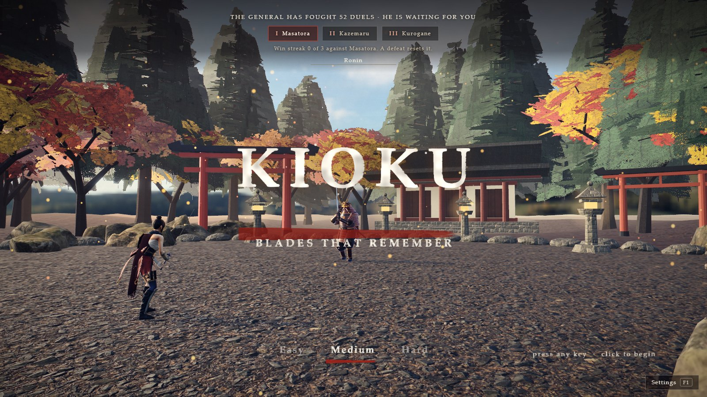
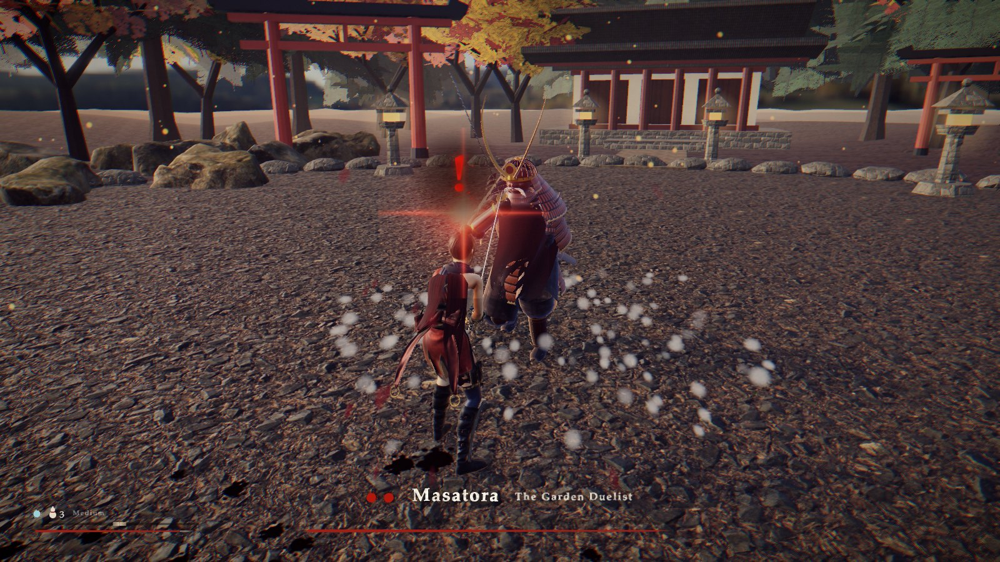
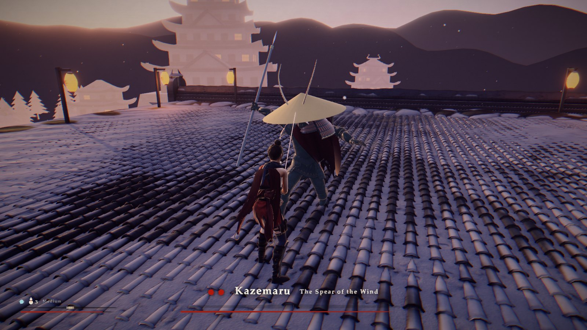
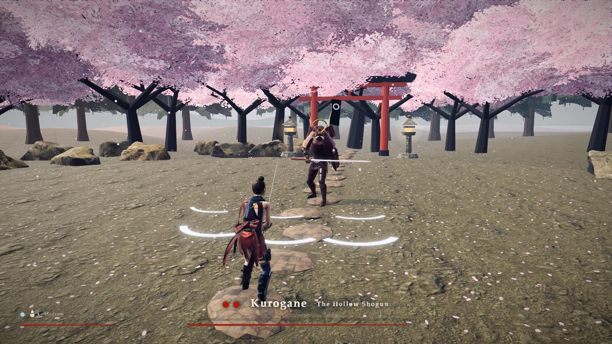

# Kioku: Blades That Remember

**A browser samurai duel where the generals learn.** Three duels, three different fighters. After every fight, won or lost, the general has read how you fight and comes back harder. The planning is done by a language model through [Mubit](https://mubit.ai); the sword-fighting is plain code.

<p align="center">
  
</p>
<p align="center">
  
  
  
</p>

Built for the Night Shift hackathon (London, 23-25 Oct 2026). Repository name: `the-general-remembers`. A fork of [shinobi-duel](https://github.com/StarKnightt/shinobi-duel) (MIT).

## The idea

| Layer | What it does | Needs a server? |
|---|---|---|
| **Memory in the game** | Every duel is counted. Each one pulls his guard, parry rate, answer speed, openings and tempo toward the HARD preset, never past it. Your deflect windows are never touched. | No |
| **The war council** (Mubit task `general_plan`) | Your duel numbers go to a model that answers with an enum-only plan: what to favour, how to open, tempo and gap steps, a line of intel and a taunt. A validator clamps it to the level's limits. | Yes |
| **His arsenal** (Mubit task `general_forge`) | The model designs his next combos, tactic, condition and a move to teach him from a numeric digest of how you fight. Checked on both sides; the game has its own deterministic arsenal when the call fails. | Yes |
| **His voice** (Mubit task `general_speech`) | A second model call writes what he says to you next duel (greeting, parry shout, last words, gloat) and rewrites his private notes on you, which feed the next plan. | Yes |

The general never stops growing: his level has no ceiling and he gets new combos, moves, feints, uneven swing speed, a condition he can only be hurt under, and a remembered form at low health. If a call fails, the same rules code runs locally and canned lines are used. The screen says which. A network call never blocks a frame.

**The generals**

| | Style | Tricks |
|---|---|---|
| Masatora, the Garden Duelist | Armoured katana duelist | Riposte stance that deflects everything |
| Kazemaru, the Spear of the Wind | Reach fighter | Lunges across the room, springs away |
| Kurogane, the Hollow Shogun | Shinobi-trained master | Vanishes in smoke, throws a fan of shuriken |

Each arena has its own music (key, scale and pace). Each general has a different human-sounding voice ([Kokoro](https://github.com/hexgrad/kokoro), open-source neural TTS, with subtitles; Settings > Sound turns it down) and ends with its own finisher: *Through the Heart*, *Wind's End*, *The Last Blossom*. The Sekiro-style tricks are the game's own picks; the model never plans them.

## Run it

Node 22+ and pnpm.

```powershell
pnpm install
pnpm -C game dev        # the game, http://localhost:5411
pnpm -C server start    # optional: API on 8787 (the game works without it)
pnpm test               # shared + game + server tests
```

Deploying the game is a static build: `vercel.json` builds `game/dist`. The server is only needed for the Mubit-planned duels.

## Mubit setup

Nothing is sent to Mubit unless **both** are set: `MUBIT_LIVE=1` in the server's environment and a key in `.env`.

1. Copy `.env.example` to `.env` (gitignored) and set `MUBIT_API_KEY=mbt_...` (Mubit console, Connect).
2. The defaults use Mubit's starter-credit model `gpt-6-luna` on `https://api.mubit.ai/openai/v1`. Groq's `gpt-oss-120b` is the backup (needs a Groq key in the Mubit console).
3. Seed and check, in order (each live script also needs `--yes-live`):

```powershell
cd server
pnpm gen:seed; pnpm gen:heldout
$env:MUBIT_LIVE="1"
pnpm exec tsx scripts/smoke.ts --yes-live        # one call
pnpm exec tsx scripts/send_seed.ts --yes-live    # 80 calls, stored: what Mubit trains on
$env:MUBIT_PER_MINUTE="6"; pnpm start             # live play
```

`general_plan` is **frozen** once seeded: Mubit groups calls into a task by model, instructions and output format, so any edit starts a new empty task. `server/test/frozen.test.ts` pins the hash. Mubit keeps examples, and trains a small adapter for the task at 25 kept examples. Whether an adapter then serves live traffic is not documented by Mubit, so the game does not depend on it.

The full story (why a model, what Mubit adds, judging self-assessment, gaps): [`docs/story.md`](docs/story.md). How the models are used, what goes in and out, and call sizes: [`docs/llm.md`](docs/llm.md). System flowchart: [`docs/architecture.md`](docs/architecture.md).

## Voices

The story lines are pre-rendered with Kokoro and shipped in `game/public/assets/voice/` (regenerate: `game/tools/make-voices.mjs`). The lines the model writes (his greeting, parry shout, last words, gloat) are spoken by the same voices through a small local sidecar the Node server calls. It is optional: without it those lines are subtitles only.

```powershell
python -m venv .venv; .venv\Scripts\pip install kokoro-onnx soundfile
# download the two model files (about 120 MB, git-ignored) into server/voice/models/ (URLs in server/voice/tts_server.py)
.venv\Scripts\python server\voice\tts_server.py     # then run the server as usual
```

## Controls

Keyboard and mouse: LMB / J strike, RMB / K guard (tap just before a blow lands to deflect), Shift step, Space jump, R gourd, WASD move, Q lock on. Controllers work automatically. **F1** opens Settings: every control, the moves list, and sound (master, music, effects, mute).

**Hands (optional, `G` or `?gestures=1`).** Your left hand is a movement stick. For everything else you train your own hand poses: F1, Hands, *Train my poses*, pick an action, hold the shape for a second and a half. One pose per action, read from a single camera frame (about 65 ms), and a new pose replaces the old one. Teach a Rest pose so a relaxed hand does nothing. Poses and video stay in your browser.

URL options: `?name=` player name, `?quality=low|high`, `?replay=1` (serve stored plans), `?gestures=1`, `?difficulty=easy|medium|hard`.

## What is where

```
game/      the duel: fighters, bosses, arenas, learn/ (memory, session), ui/, input/ (poses)
shared/    pure logic used by game and server: habits, plan contract + validator, levels, grader
server/    Express API, node:sqlite memory, Mubit client, the two tasks, eval harness, dashboard
data/      seed.json, heldout.json (committed); calls.csv and eval/ are git-ignored
docs/      llm.md, architecture.md, walkthrough.md, demo-script.md, verification.md
```

## Credits

See [`NOTICE.md`](NOTICE.md): shinobi-duel (MIT), Kenney sound packs (CC0), Poly Haven textures and HDRIs (CC0), three.js, pmndrs postprocessing, N8AO.
