# Kioku: Blades That Remember

> **Bored of fighting the same boss, with the same moves, again and again?**

<p align="center">
  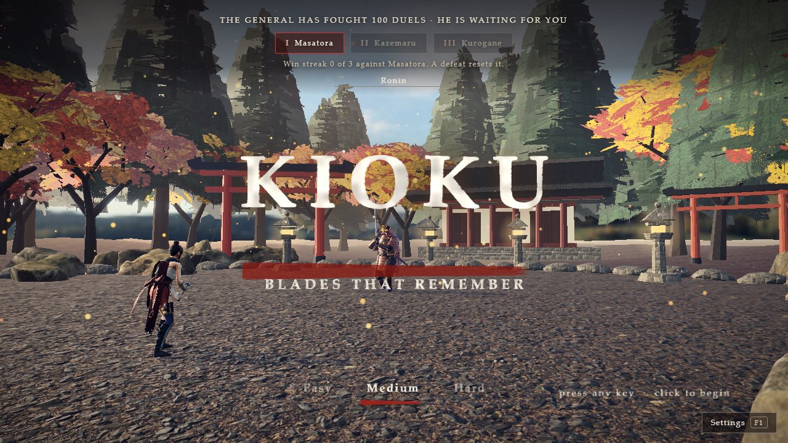
</p>

<p align="center"><b>A samurai duel where the generals study you, and come back different every time.</b><br/>
Three generals, three arenas, and three jobs for a language model, all through Mubit.</p>

<p align="center">
  <a href="#what-the-demo-shows">What the demo shows</a> ·
  <a href="#how-kioku-uses-mubit">How Kioku uses Mubit</a> ·
  <a href="docs/architecture.md">Architecture</a> ·
  <a href="docs/features.md">Features</a> ·
  <a href="#run-it">Run it</a>
</p>

**At a glance:** 3 Mubit tasks, about 2,400 stored calls, 3 trained adapters (Qwen3-4B v1; the plan adapter matches the
provider model on 75% of test cases, target 85%), a model that never sits in the frame loop, 305 passing tests, about
58 fps in fights. Details and the console screenshot: [How Kioku uses Mubit](#how-kioku-uses-mubit).

Built at the Night Shift hackathon (Mubit), London, 23 to 25 October 2026.

---

## What it is

Kioku is a browser samurai duel (Three.js, nothing to install) in three chapters. The twist is the opponent. After every
duel, **won, lost or forfeited**, the general you fought studies how *you* fight: how often you attack, guard, deflect
and dodge, and whether you stand close or keep away. He then comes back harder and *different*: new combos, new moves,
a new way to keep you where he wants you, and a **condition** you must break before he bleeds. A language model, through
[Mubit](https://mubit.ai), plans his next fight, writes what he says to you, and designs his new combos. The sword
fighting itself is plain game code, so a slow or wrong model answer can never break a duel.

## The problem

- **Bosses are scripts.** A boss is a fixed list of moves. Players memorise it, then one-shot it. The fight that felt
  epic on night one is a chore by night five. The game gets *easier* the longer you play it.
- **"Adaptive" AI is shallow.** Most games nudge a difficulty number. The boss never changes *how* it fights, and never
  notices *how you* fight.
- **A large model on every swing is the wrong tool.** It costs money, adds delay and can make a fight unfair.
  A model *between* duels, choosing what the boss becomes next, is exactly the right job for it.
- **No studio can rent a frontier model per player forever.** The judgement has to move into a small, cheap model that
  is trained on the game's own traffic. That is what Mubit is for.

### How big it is

| | |
|---|---|
| **$201.6 billion** | the global games market in 2025, up 9.1% on 2024 ([Newzoo, via GameDev Reports](https://gamedevreports.substack.com/p/newzoo-the-games-market-in-2025); the figure is from secondary coverage of Newzoo's report) |
| **About 3.6 billion** | players worldwide in 2025 (Newzoo's September 2025 forecast: 3.578 billion, 61.5% of the world's population) |
| **$113.3 billion** | of it from mobile, where an always-on model per player is the most expensive and the cheap small model matters most |

### Who pays for it

- **Studios with a boss-driven or live-service game.** Boss encounters are the most-replayed, most-shared moment in a
  game and the first one players solve. A boss that keeps changing is a retention feature.
- **Indie teams.** They cannot hand-author a hundred boss variations, and cannot afford a frontier-model bill per player.
- **Anyone building AI game directors.** The pattern (a small numeric digest in, a validated plan out, a small model that
  takes over) is reusable well beyond duels.

## What the demo shows

The two-minute demo walks through this, in this order (screenshots below are from the real build):

1. **Title and Settings.** The title names the three generals and the difficulty; Settings lists every control and move.
2. **Narrated prologue and chapter card.** Human-sounding voice, subtitles on screen.
3. **The parley and the duel.** Keyboard or your own hand poses. The banner on screen says what condition he is hiding behind.
4. **A guard that works.** Deflect his blows, break his posture, finish him with his own finisher.
5. **The war council.** After the duel the screen shows what he read about *you*, his level, what he learned, and what the
   language model designed: its own named combos, the tactic (keep away from a close fighter, crowd a kiter) and a move to teach him.
6. **The rematch.** He is visibly different: new combos, a changed distance, a different condition. He speaks a line written for you.
7. **The gate to the next chapter, then the second general** on a different arena with a different style.
8. **Pause menu.** Resume, switch keyboard or hands, volumes, controls, and the way out (which forfeits).
9. **Mubit.** The call log with request ids, the three tasks, the measured cost and speed, and the adapter status (below).

<p align="center">
  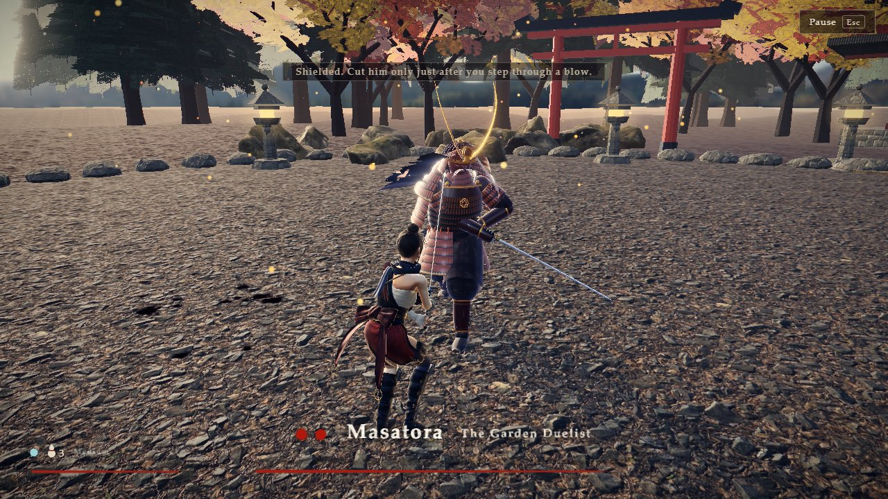
  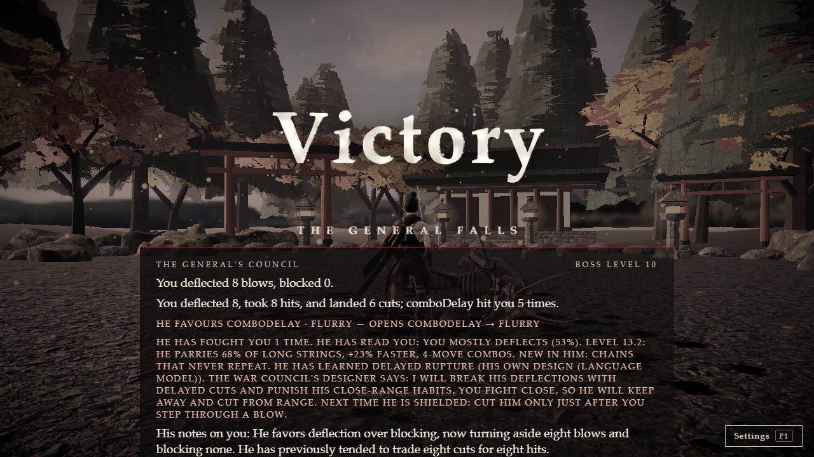
</p>

---

## How Kioku uses Mubit

**Every language-model call in Kioku goes through Mubit** (`https://api.mubit.ai/openai/v1`). The game is split into three small, single-purpose jobs on purpose, so each is its own **Mubit task**. Mubit records each call, groups calls by task, keeps examples, and trains a small model (an adapter) for that one job.

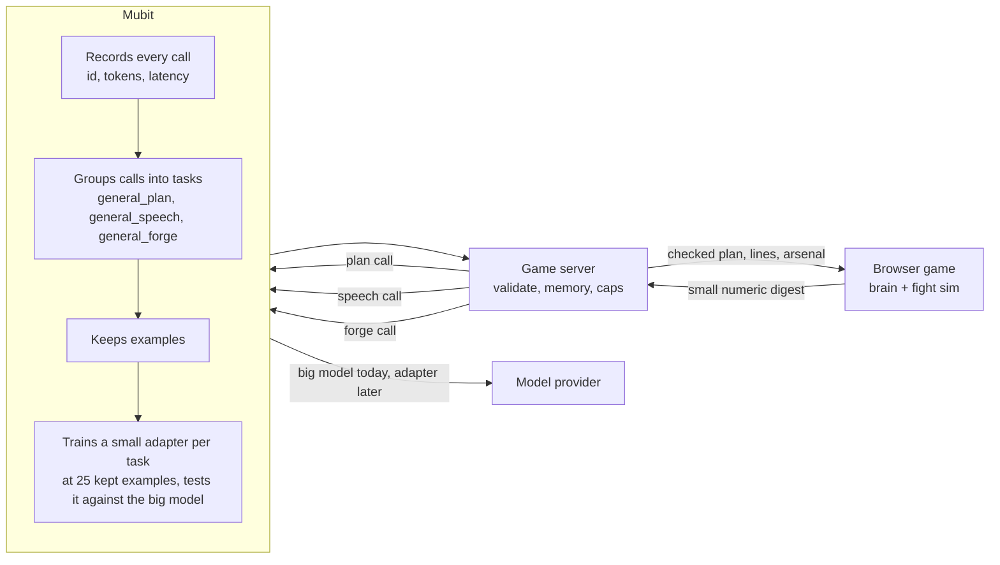

### What Mubit does

1. **Records** every call with a request id, token counts and latency. The game's own log (`data/calls.csv`) keeps the
   request id for every duel, so a bad answer can be traced and marked in the Mubit console.
2. **Files each call under its task** (same model, instructions and output format). We run three.
3. **Keeps examples** and, once a task has 25, **trains a small adapter** for it and tests it against the provider model's answers.
4. **Lets the model behind a task change** (big model now, adapter later) without touching the game.

### What we send

Three tasks, each with a fixed system prompt and a strict JSON answer. Measured from our own call log:

| Mubit task | When it runs | What goes in (never free text from the player) | What comes out | Median call | Adapter fit |
|---|---|---|---|---|---|
| `general_plan` | after every duel | the duel's counts, your top habits, his notes on you, difficulty caps | focus habit, opening strings, tempo and gap steps, one intel line | 797 tokens in, 298 out, 3.5 s | **Very good** (enum-only output) |
| `general_forge` | after every duel | his level, your style shares, where you stand, which of his moves land | up to 3 named combos, tactic, condition, one move to teach | 922 in, 327 out, 4.1 s | Good (validated lists) |
| `general_speech` | after every duel | how the duel went, your habits, his previous notes | his notes on you, a greeting, a parry shout, last words, a gloat | 550 in, 430 out, 4.6 s | Medium (free text, short) |

The plan task is designed to be copied by a small model: its answer is a handful of enums and small integers, never a free number,
and its input is compact (about 700 tokens). That is why an adapter can take the job over.

### What the game keeps

Mubit does not hold the game's memory. The game does: the **brain** per general per player (style, which of his moves
land on you, his level, where you stand) lives in the browser and decides how he fights, even with no server at all.
Mubit and the model supply the judgement and the words *between* duels; the game supplies the facts.

| Owner | Decides | Never does |
|---|---|---|
| Game code | Frames, hit windows, deflect timing, habits, difficulty, his level, conditions, combos he can play | Write his words |
| Model (through Mubit) | What he favours next, his arsenal design, what he says, his notes on you | Change a fact or break a rule: every answer is checked |
| Server | Validation, per-player memory, rate caps, fallbacks | Trust a model answer as it came |

### The validator

Every answer is checked on the server and again in the game: plans are clamped to the player's level (`validatePlan`),
speech is capped in words and filtered (`cleanSpeech`), and the arsenal design may only use moves he can play, within a
bounded length, with no move repeated back to back and never three perils in a row (`cleanForge`). Anything invalid is
dropped and the game uses its own deterministic plan, lines or arsenal. The model is never in the frame loop.

### How this helps

The instructions never change; only the numbers change. So the same three jobs repeat for every duel of every player,
which is exactly the shape of work Mubit's adapters are for. Today the big model answers; once an adapter passes its
tests, the same task can run on a small, cheap model. The game does not depend on the adapter, so it keeps working
either way.

### Adapters, and what we have trained on

Stored through Mubit so far (`data/calls.csv`, request id on every row): **about 2,400 successful calls across the three tasks**,
0 failures in the last 900-call batch (400 plan, 200 speech, 300 forge). Batches use different random seeds so the tasks
are not trained on repeats. Plan inputs come from simulated players of every habit (deflector, turtle, dodger,
aggressive, passive, healer, mixed), forge inputs from generals at levels 1 to 31 against every style at every distance.

**Mubit has trained a first adapter for each of the three tasks** (Qwen3-4B-Instruct-2507, a 4B model, v1). Screenshot of
our Mubit console, Adapters page, 25 Oct 2026:

<p align="center">
  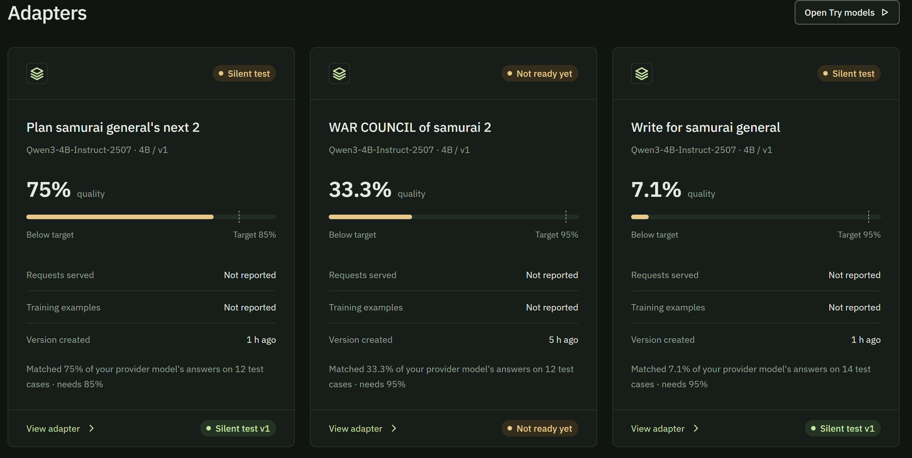
</p>

| Mubit task (title in the console) | Adapter | Quality: matched the provider model's answers | Test cases | Target | Status |
|---|---|---|---|---|---|
| Plan samurai general's next (`general_plan`) | Qwen3-4B v1 | **75%** | 12 | 85% | Silent test |
| WAR COUNCIL of samurai | Qwen3-4B v1 | 33.3% | 12 | 95% | Not ready yet |
| Write for samurai general | Qwen3-4B v1 | 7.1% | 14 | 95% | Silent test |

What this says, plainly:

- **The plan task is closest.** Its answer is enums and small integers, so a 4B model already matches the big model on 3 of 4
  held-back cases. It is 10 points under Mubit's 85% bar; more varied examples are the lever, and we keep sending them.
- **The two free-text tasks are far off**, as predicted: exact agreement with a big model on written lines and designed combos
  is the hardest thing to measure, and the test sets are small (12 and 14 cases), so these numbers are noisy.
- **No adapter has passed its bar yet**, so none serves live traffic. The game never depends on it: the provider model
  answers, the validator checks every answer, and a rules fallback sits under that.
- Mubit lists "Requests served" and "Training examples" as *Not reported* for these versions, so we do not quote them.
- Which console title belongs to which of our two free-text tasks is read from the titles Mubit generated; the plan one is unambiguous.

### What Mubit saves, measured

From the token counts above and Mubit's own price table for the models (list prices per million tokens, input and output;
the small model is `gpt-6-luna`, the frontier tier `claude-haiku-4-5` and `gpt-6-sol`). A duel makes three calls.

| One duel (three calls) | Small model (`gpt-6-luna`, what we run) | Frontier (`claude-haiku-4-5`) | Frontier (`gpt-6-sol`) |
|---|---|---|---|
| Cost per 1,000 duels | **$0.75** | $7.54 | $15.09 |
| 10,000 players, 3 duels a day, a month | about **$680** | about $6,800 | about $13,600 |
| 100,000 players, 3 duels a day, a month | about **$6,800** | about $68,000 | about $136,000 |

These are projections from measured token counts and list prices, not quotes. The point is the shape: the three jobs are
small and repeated, so a small model that matches the big one is worth an order of magnitude. Mubit is how Kioku gets
there without rewriting the game.

**Privacy.** The model only ever sees a small numeric digest (shares and counts, never what the player typed, never a
name). The per-player memory stays in the browser.

### Held-out evaluation of the plan task

60 simulated players that were never sent to Mubit for training (`data/heldout.json`, sent with storage off), scored by
code against the counters the game accepts for each player's strongest habit (`server/scripts/eval.ts`).

| | Rules table (no model) | Model through Mubit (`gpt-6-luna`, compact plan) |
|---|---|---|
| Valid plans (inside the level's limits) | 100% (self-graded: the labels come from the same table) | **98.3%** (59 of 60) |
| Plans that counter the player's strongest habit with an accepted move | 100% (same caveat) | **95.0%** |
| Median / p95 call time | under 0.05 ms (local) | 3.9 s / 4.9 s |
| Mean tokens per call (in / out) | none | 793 / 292 |
| Token cost per 1,000 plan calls | none | $0.23 (the harness's cost model also adds Mubit's $5 per 1,000 runs) |

The rules table is the floor the game falls back to, so the model is only worth using if it beats it where it matters:
it does not hand the player a plan that is wrong for them, and it reads the habit mix the table cannot (a player who both
holds guard and heals). This is also the test an adapter has to pass: the same 60 items, answered by the small model.


---

## The generals

<p align="center">
  
  
  
</p>

| | Style | Tricks | Finisher |
|---|---|---|---|
| **Masatora**, the Garden Duelist | Armoured katana duelist | Riposte stance that deflects everything | *Through the Heart* |
| **Kazemaru**, the Spear of the Wind | Reach fighter | Lunges across the room, springs away | *Wind's End* |
| **Kurogane**, the Hollow Shogun | Shinobi-trained master | Vanishes in smoke, throws a fan of shuriken | *The Last Blossom* |

Each has its own arena (shrine courtyard, rooftop at dusk, sakura garden), music (key, scale and pace), narrated cut
scenes and a human-sounding voice. The story: Kaede, last of the village of Kiri, hunts the three generals of the Order of
the Remembering Blade, who never forget a fighter.

<p align="center">
  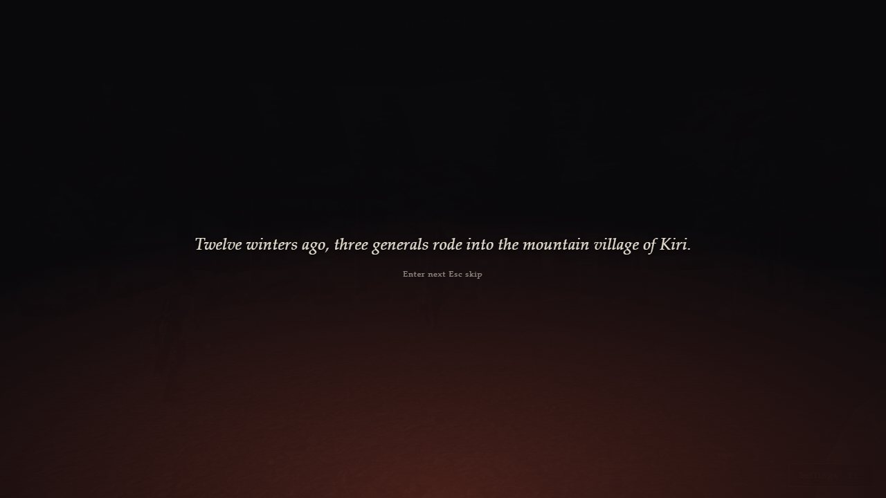
  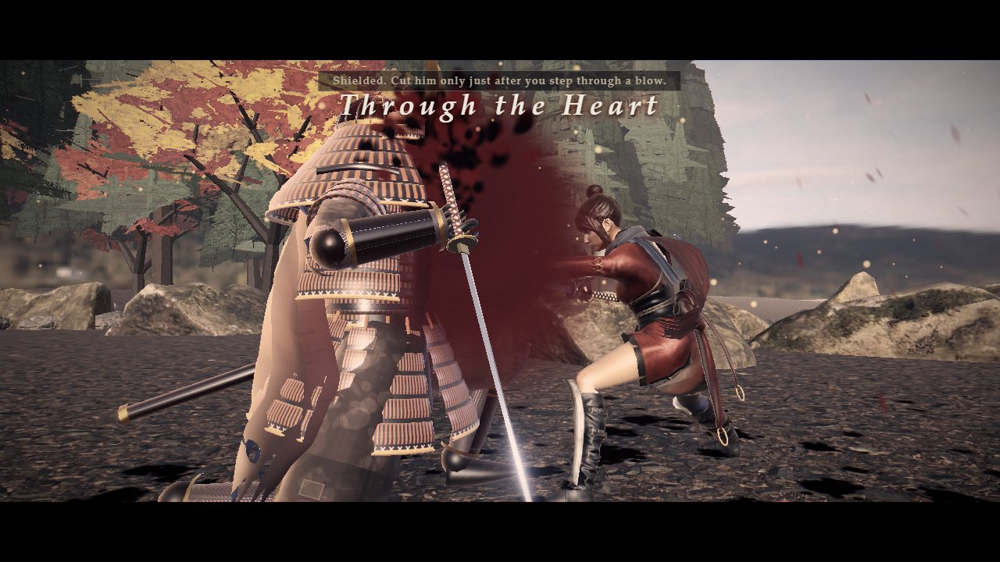
  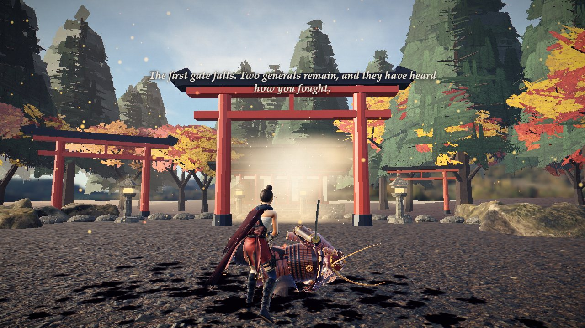
</p>

### How he gets harder, with no ceiling

After every duel his level rises (more for a clean win), the game blends your style with the new duel, scores each of his
moves by how often it landed on you, and aims a condition at what you lean on. His parry chance, answer speed, openings,
tempo and combos all scale with the level, past the old "hard" limit with no cap. New moves unlock (a thrown cut at level 5,
a lunge at 8, a backflip at 11, a leaping flurry at 14, a ground slam at 17, a smoke vanish at 20, the riposte at 24). He has
12 named combos from the hardest fights in games (Isshin's Ashina Cross, the Owl's delayed cuts, Malenia's Waterfowl Dance,
Lord Shimura's slam...), each with why it is hard and what answers it. Below 30 health, a general who has learned enough turns
on you in a **remembered form**. Your deflect windows and damage are never touched.

## Controls

- **Keyboard and mouse:** LMB / J strike, RMB / K guard (tap just before a blow to deflect), Shift step, Space jump,
  R gourd, WASD move, Q lock on. Controllers work automatically.
- **Hands (optional, G):** your left hand is a movement stick; for everything else you **train your own hand poses**: one pose per
  action, read from a single camera frame (about 65 ms), either hand or both at once. Poses and video never leave the browser.
- **Pause (Esc or the Pause button):** resume, switch keyboard or hands, four volume sliders, controls and moves, and the
  way back to the main menu (which **forfeits** the duel; he learns from that too).
- **Settings (F1):** every control, the moves list, sound.

<p align="center">
  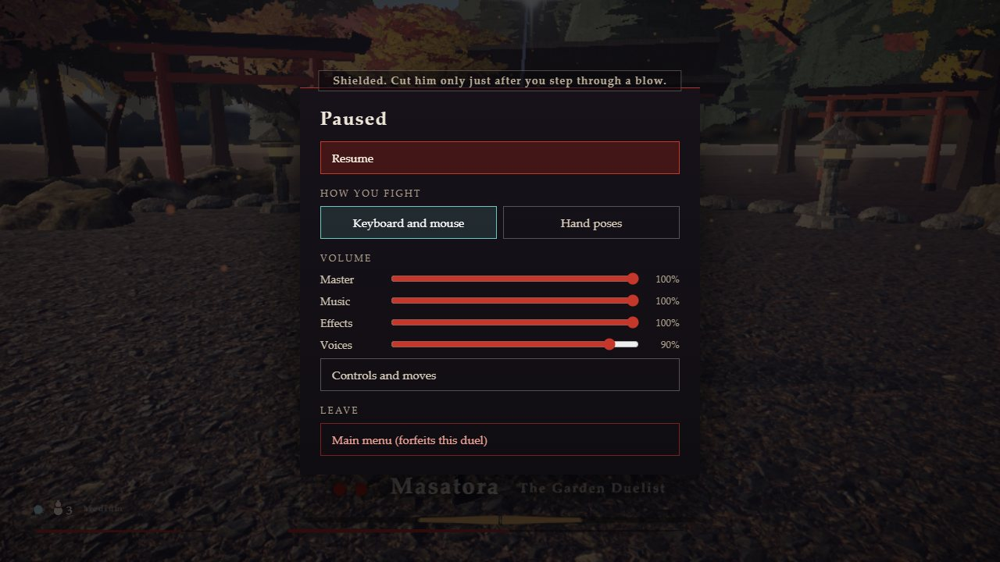
  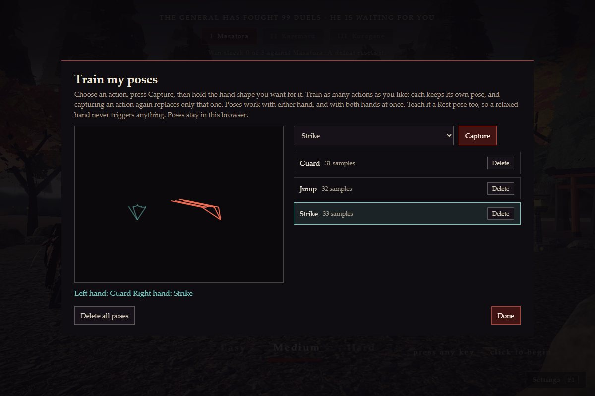
  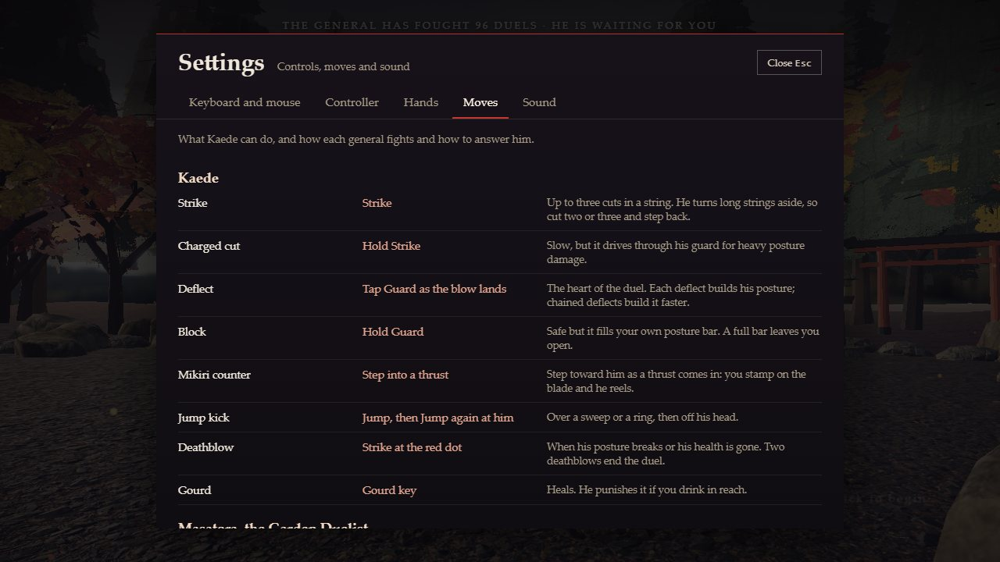
</p>

## Run it

Windows with PowerShell, Node 22+ and pnpm (the commands also work on macOS and Linux).

```powershell
pnpm install
pnpm -C game dev                # the game, http://localhost:5411
pnpm -C server start            # optional: the API and the Mubit calls (the game works without it)
pnpm test                       # shared + game + server tests
node game/tools/fullcheck.mjs   # a full pass through the game in a real browser, bot fighting
```

Without the server the game still plays and the general still learns (the brain is in the game); the model-designed
parts and the spoken model lines need the server.

### Mubit setup

Nothing is sent to Mubit unless **both** are set: `MUBIT_LIVE=1` in the server's environment and a key in `.env`.

1. Copy `.env.example` to `.env` (git-ignored) and set `MUBIT_API_KEY=mbt_...` (Mubit console, Connect).
2. Defaults use Mubit's starter-credit model on `https://api.mubit.ai/openai/v1`. Groq's `gpt-oss-120b` is the backup.
3. Seed the tasks, then send more examples (each live script also needs `--yes-live`):

```powershell
cd server
$env:MUBIT_LIVE="1"
pnpm exec tsx scripts/smoke.ts --yes-live          # one call
pnpm exec tsx scripts/send_seed.ts --yes-live      # 80 stored plan examples
pnpm exec tsx scripts/send_more.ts --yes-live      # more, for all three tasks (set SEED for fresh ones)
pnpm exec tsx scripts/eval.ts --label provider --yes-live   # 60 held-out items, never stored
$env:MUBIT_PER_MINUTE="12"; pnpm start             # live play
```

A task is the model plus its instructions plus its output format, so editing a prompt starts a new, empty task
(`server/test/frozen.test.ts` pins the hash).

### Voices

Story lines are pre-rendered with [Kokoro](https://github.com/hexgrad/kokoro) (open-source neural TTS, Apache-2.0) and ship in
`game/public/assets/voice/` (`game/tools/make-voices.mjs` regenerates them). The lines the model writes are spoken by the
same voices through an optional local sidecar:

```powershell
python -m venv .venv; .venv\Scripts\pip install kokoro-onnx soundfile
# put kokoro-v1.0.int8.onnx and voices-v1.0.bin in server/voice/models/ (URLs in server/voice/tts_server.py)
.venv\Scripts\python server\voice\tts_server.py
```

## Tests and checks

```powershell
pnpm test                          # shared 57, game 143, server 105
node game/tools/fullcheck.mjs      # title, Settings, narrated prologue and cards, parley, movement, shield banner, pause,
                                   # finisher, victory, council, gate, next chapter
node game/tools/pause-check.mjs    # the pause menu, resume, forfeit counts as a defeat
node game/tools/pose-check.mjs     # the pose trainer on a fake camera: every pose kept, two hands, reload
node game/tools/brain-run.mjs      # a high-level general in a real browser
node game/tools/flowperf.mjs       # frame pacing through the whole flow (about 58 fps in fights)
```

## Project layout

| Path | Holds |
|---|---|
| `game/src/learn/` | `brain.ts` (style, move scores, level, conditions, skills), `arsenal.ts` (named combos, moves learned by level, range tactic), `session.ts` (the call to the server) |
| `game/src/game/` | Fighters, bosses, the fight sim, story, pause logic |
| `game/src/input/` | Keyboard, controller, hand poses (`poses.ts`) |
| `game/src/ui/` | Title, council screen, subtitles, pause menu, pose trainer, settings, voice |
| `shared/src/` | Habits, plan contract, forge validation, levels: used by game and server |
| `server/src/` | The API, memory, the Mubit client, the three tasks (`prompts/`), the voice sidecar caller |
| `server/voice/` | The local Kokoro text-to-speech sidecar |
| `data/` | `seed.json`, `heldout.json`; `calls.csv` and `eval/` are git-ignored |
| `docs/` | `architecture.md`, `llm.md`, `story.md`, `features.md`, `walkthrough.md`, `demo-script.md`, `img/` |

## Honest notes

- **Adapter numbers are read by hand from our Mubit console** (screenshot above); the API did not let us read them. All three are v1 and below target.
- **Costs are projections** from measured token counts and list prices, not quotes. We have not measured an adapter's own cost.
- **Hand poses are tested end to end on a fake camera**, not yet with a real webcam.
- **How fun and fair a level-20 general is** needs human players; our bot is far too precise to judge it.
- **Voices and music** were checked by file and by timing, not by ear.

## Team

Iyad Zuberi ([@IyadZuberi](https://github.com/IyadZuberi)).

## Credits

See [`NOTICE.md`](NOTICE.md).
