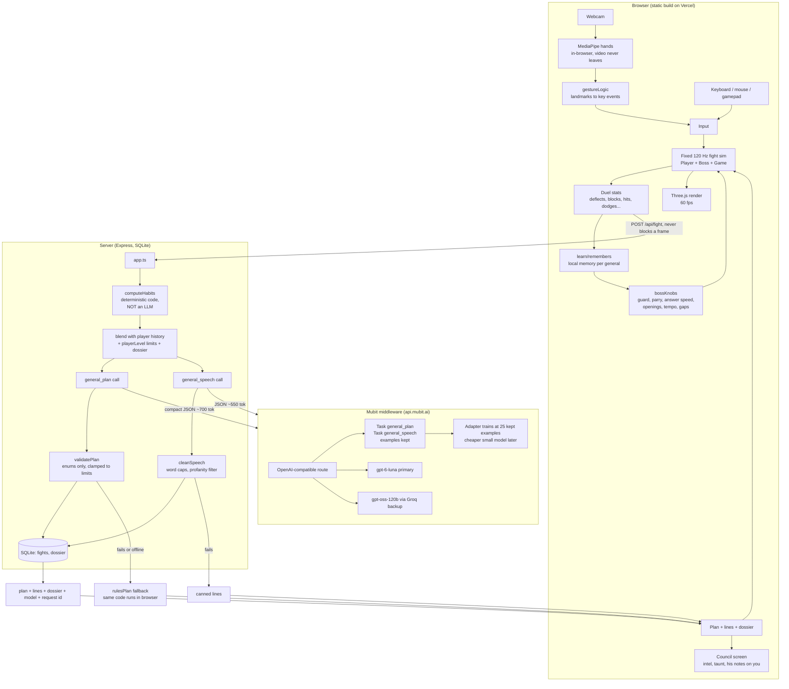

# Architecture

## What each model call gets and returns

| | `general_plan` | `general_speech` |
|---|---|---|
| Input | boss, streak, level, win/loss, duel counts (deflects, blocks, hits, dodges, cuts), moves that hurt, top 3 habits with power, his notes on the player, losses in a row, caps for the player's level, designer rules | boss, fight number, win/loss, level, habits with evidence, previous dossier, council intel |
| Output | `focus` habit, `strings` (opening move strings), `high` / `low` moves, `tempo`, `gap`, `intel` (20 words), `taunt` (10 words) | `dossier` (30 words), `greeting`, `parry`, `fall`, `win` |
| Game uses it for | difficulty knobs and openings (after validation), council text | subtitles in the duel, and the dossier fed into the next plan |
| Without it | rules table plan | canned lines |

Habit detection, difficulty maths, validation and all gameplay are plain code. The models choose and write; they never run a frame.
