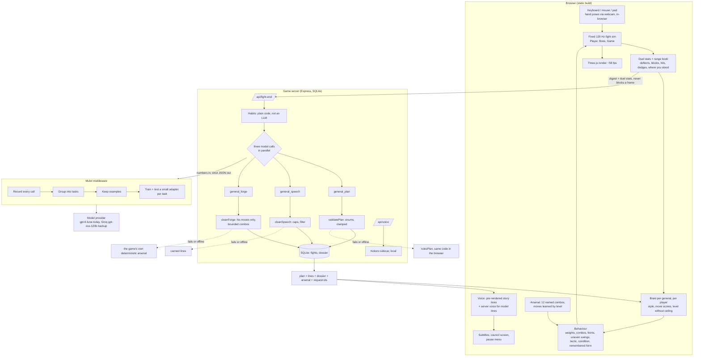

# Architecture

## The whole system

## What lives where, and why

| Part | Where | Model in the loop? | Why |
|---|---|---|---|
| Frames, hit windows, deflect timing | game | never | must be instant and fair |
| Habit detection | `shared/habits.ts` | never | a threshold is the right tool |
| Brain: style, move scores, level, combos, feints, conditions | `game/learn/brain.ts`, `arsenal.ts` | no | works offline, deterministic, tested |
| Plan, speech, arsenal design | server, through Mubit | yes, between duels | judgement and writing, never per frame |
| Validation of every model answer | server and game | no | a model can be creative but never unfair |
| Voice | pre-rendered Kokoro + local sidecar | no | human-sounding, free, offline |

## The role of Mubit, precisely

1. **Observability.** Every model call is recorded with a request id, token counts and latency. The game's call log
   (`data/calls.csv`) and the console's Requests page are the evidence for every claim.
2. **Task grouping.** Mubit groups calls with the same model, instructions and output format into a **task**. We run
   three: `general_plan`, `general_speech`, `general_forge`. Each has a strict JSON output so a small model can copy it.
3. **Example keeping.** Mubit keeps examples from those calls. We seeded and then sent more (plan, speech and forge
   examples) so each task has well over the 25 examples Mubit needs to start training.
4. **Adapter training and testing.** At 25 kept examples (and when training is enabled for the workspace) Mubit
   trains a small adapter for the task and tests it against the provider model's answers. A passing adapter can be compared
   with the large model in the console's Try models page.
5. **Model swap without code changes.** Behind a task the model can change (large model now, adapter later) and the game
   server does not.

**The adapter path:** live play and seeded examples go through Mubit (stored) → Mubit groups them into
tasks → at enough examples it trains and tests an adapter → a passing adapter is compared with the large model →
the task is pointed at the cheaper adapter. Mubit's documentation does not say whether an adapter then serves live traffic
by itself, so the game never depends on it: with or without an adapter, the validators and fallbacks keep the duel fair.

**Honest status:** all three tasks receive live calls through Mubit and return valid, checked answers with request ids.
Whether training has started depends on Mubit enabling training for the workspace (per its documentation the console shows no
Adapters page until it is). That is read in the console (Requests, Tasks, Adapters), not from code, because Mubit's admin
endpoints are refused through the API.

## Inputs and outputs of the model calls

| | `general_plan` | `general_speech` | `general_forge` |
|---|---|---|---|
| Input | boss, streak, level, win/loss, duel counts, moves that hurt, top 3 habits, his notes, losses in a row, caps for the level, designer rules | boss, fight number, win/loss, level, habits with evidence, previous notes, council intel | his level, your style shares, where you stand (near share, hits near/far), his move list, moves that land / never land, current condition |
| Output | focus habit, opening strings, moves to favour / ease off, tempo, gap, intel (20 words), taunt (10 words) | notes (30 words), greeting, parry shout, last words, gloat | up to 3 named combos (3-8 moves), tactic, condition, one move to teach, a note |
| Checked by | `validatePlan` (enums, limits for the player's level) | `cleanSpeech` (word caps, profanity) | `cleanForge` (only his moves, bounded, no spam, no three perils in a row) |
| Without it | rules table plan | canned lines | the game's own arsenal |

Sizes: about 700 tokens in for the plan, 550 for speech, 900 for the forge; outputs 250-500 tokens (most of it hidden reasoning).

## How he gets harder, with no ceiling

Per general and per player, after every duel (win, loss or forfeit): the level rises (more for a clean win), the style
is blended (55% new duel), each of his moves gets a hit rate against you, the range book fades 15% and takes in where
you stood, and the condition is aimed at what you lean on (changed if you beat it). Everything scales with the level:
parry chance, answer speed, openings, tempo (log growth past level 10), gap length, combo count and length, feints,
uneven swing speed, new moves (windSlash at 5, lunge at 8, backflip at 11, waterfowl at 14, shockwave at 17, vanish at 20,
stance at 24), and the remembered form below 30 health once the level reaches 6. The player's deflect windows and damage
are never touched.
